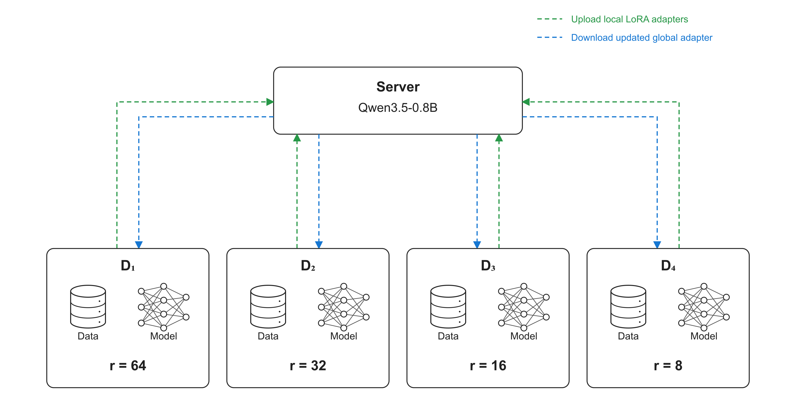
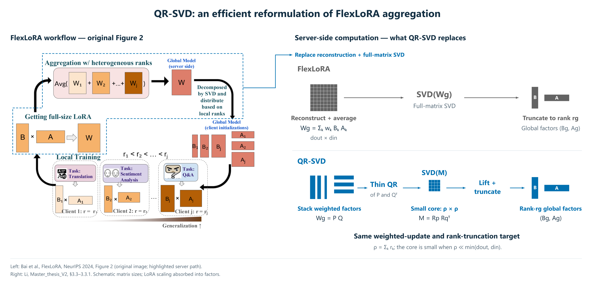
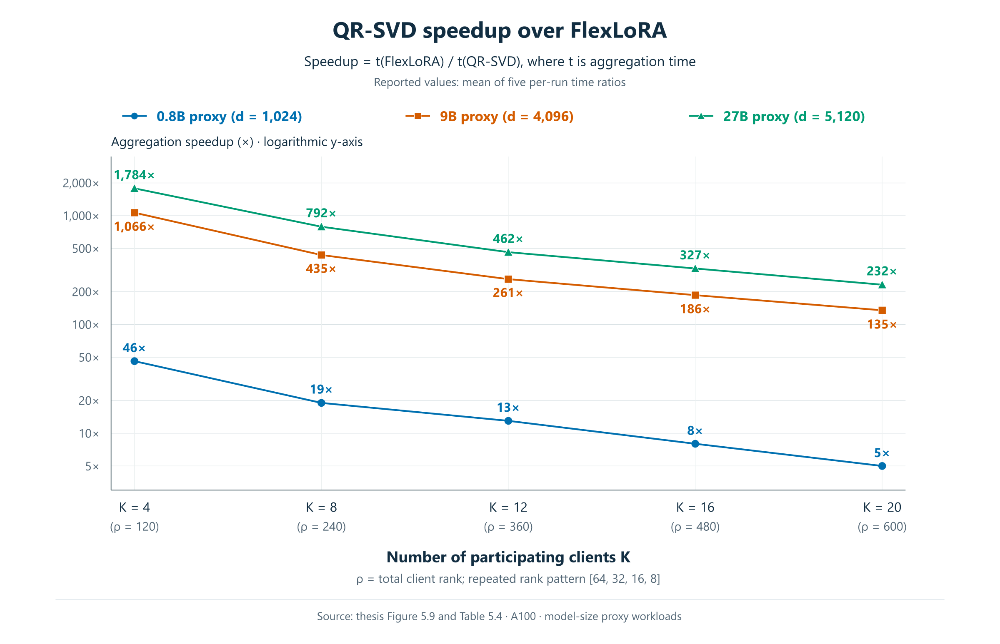

# Master's Thesis: Heterogeneous Federated Fine-Tuning of Foundation Models

**Thesis:** [Read the PDF on DiVA](https://uu.diva-portal.org/smash/get/diva2:2108786/FULLTEXT01.pdf)

## Background

**Federated learning (FL).** Instead of uploading large raw datasets to the cloud, FL allows institutions to train a shared model while keeping data local. This helps protect privacy, can save upload bandwidth, and supports edge deployments with local, real-time inference.

**LLM/VLM fine-tuning.** Large language models can be adapted to domain-specific tasks through fine-tuning. In this thesis, we use [Qwen3.5-0.8B](https://huggingface.co/Qwen/Qwen3.5-0.8B), a vision-language model with approximately 0.8 billion parameters.

**LoRA (Low-Rank Adaptation).** Updating all model parameters requires substantial GPU memory. LoRA is a parameter-efficient fine-tuning (PEFT) method that freezes the base model and learns updates through two small trainable matrices. Their inner dimension, **rank $r$**, controls adaptation capacity: higher ranks allow more flexible updates but require more trainable parameters, memory and communication. In our Qwen3.5-0.8B configuration, ranks of **8–64** correspond to **6.6M–52.7M trainable parameters**, or **0.8%–6.2%** of the full model’s **847M parameters**.

## Dataset

We use [PathVQA](https://huggingface.co/datasets/flaviagiammarino/path-vqa), a pathology visual question-answering dataset. Each sample contains an image, a question and its answer.

## Use case and experimental setting

We consider four hospitals, each holding local pathology images and question–answer pairs. Regulatory constraints prevent them from sharing their raw data. Instead of each hospital fine-tuning its own model, they use **federated fine-tuning** to train a shared model while keeping data local.

The hospitals have different computing and GPU memory budgets, so they use different LoRA ranks: **64, 32, 16 and 8**. In our experiments, this setting is simulated using four clients with local partitions of PathVQA.

## How do we aggregate LoRA updates with different ranks?

The four hospitals have different computing and GPU memory budgets, so they use different LoRA ranks to control adaptation capacity and the number of trainable parameters. However, different ranks produce parameter matrices with different shapes—how can the server aggregate them?

**FedAvg** assumes the same LoRA rank across clients, making it suitable for a uniform-rank setting but unable to directly aggregate the different-shaped parameters in our hospital scenario.

**HETLoRA** uses zero-padding to align parameter shapes for aggregation and local rank self-pruning to reduce adapter size.

**FlexLoRA** reconstructs full-size weight updates, averages them, and applies SVD to obtain adapters at each client’s rank. However, SVD on these large matrices is expensive: our four-client aggregation benchmark takes **42.52 seconds per round** on an NVIDIA A100 GPU (Table 5.5).

## What is QR-SVD?

To reduce the cost of FlexLoRA’s full-matrix SVD, we propose **QR-SVD**, the aggregation method developed in this thesis.

FlexLoRA reconstructs and averages the client weight updates into a full $d_{\mathrm{out}}\times d_{\mathrm{in}}$ matrix, then performs SVD on this full matrix and truncates the result to the target rank. Here, $d_{\mathrm{out}}$ and $d_{\mathrm{in}}$ are the output and input dimensions of the adapted weight matrix.

QR-SVD instead stacks the weighted low-rank factors, performs two thin QR decompositions, and applies SVD to a $\rho\times\rho$ core matrix. Mapping the singular vectors back to the original dimensions produces a numerically equivalent rank-constrained update without explicitly forming the full weight-update matrix. Local training follows FlexLoRA.

**The key efficiency condition:** in the intended low-rank setting, the total client rank is much smaller than the full matrix dimensions:

$$
\rho=\sum_{k=1}^{K}r_k \ll \min(d_{\mathrm{out}},d_{\mathrm{in}}).
$$

For example, with $\rho=120$ and $d_{\mathrm{out}}=d_{\mathrm{in}}=1024$, the core SVD operates on a **120 × 120** matrix instead of a **1024 × 1024** matrix.

Method: thesis §3.3–3.3.1. Left workflow: Figure 2 of [Bai et al., NeurIPS 2024](https://proceedings.neurips.cc/paper_files/paper/2024/hash/1a134b50202088aa8c595cc99b310e5a-Abstract-Conference.html); the right panel highlights the QR-SVD reformulation.

## Does QR-SVD preserve model accuracy?

**The evaluated runs achieve similar accuracy:** QR-SVD reaches **59.00%**, compared with FlexLoRA's **59.10%**, a difference of **0.10 percentage points**.

| Method | LoRA rank configuration | Final validation accuracy |
|---|---|---:|
| Centralized | r = 32 | 60.23% |
| FedAvg | r = 64 | 61.89% |
| FedAvg | r = 32 | 59.34% |
| HETLoRA | [64, 32, 16, 8], γ = 0.99 | 59.27% |
| FlexLoRA | [64, 32, 16, 8] | 59.10% |
| **QR-SVD** | **[64, 32, 16, 8]** | **59.00%** |

Source: thesis Table 5.5. Qwen3.5-0.8B on PathVQA validation (6,259 samples); federated scores are at round 9. Centralized r = 32 uses 1,000 steps with batch 256. The three heterogeneous methods differ by at most 0.27 percentage points in these runs.

## How much faster is QR-SVD aggregation?

The figure combines the three model-proxy curves from thesis Figure 5.9 / Table 5.4. Each curve uses five runs on an A100; increasing the client count also increases the total rank.

$$
\mathrm{Speedup}_i=\frac{t_{\mathrm{FlexLoRA},i}}{t_{\mathrm{QR\text{-}SVD},i}},\qquad
\mathrm{plotted\ speedup}=\frac{1}{5}\sum_{i=1}^{5}\mathrm{Speedup}_i.
$$

Here, $t$ denotes aggregation time; larger values mean greater acceleration.

[Original five-run benchmark JSON](results/benchmarks) · [Recompute the summary](eval/summarize_benchmarks.py)

## What scenarios is QR-SVD best suited for?

**Cross-silo federated learning** involves a small, stable set of organizations training a shared model while keeping their data local. As the figure above shows, QR-SVD is particularly attractive for large weight matrices when the total participating LoRA rank $\rho$ is small relative to the matrix dimensions.

For setup and commands, see the [running guide](docs/running.md).

Accuracy values are reported thesis results; per-sample validation prediction files are not included in this snapshot.

