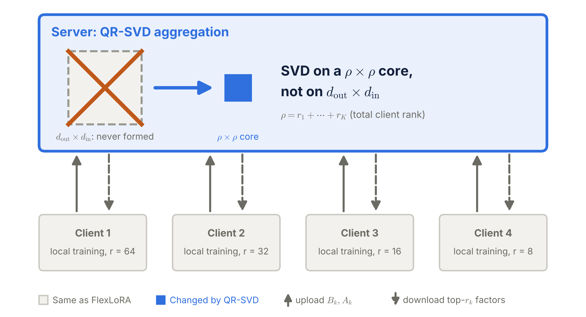
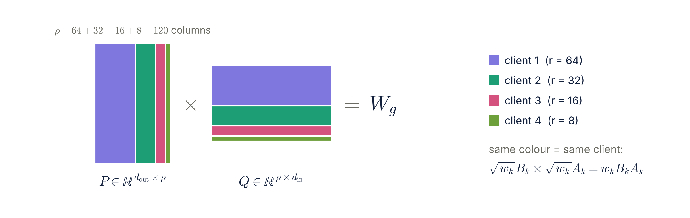
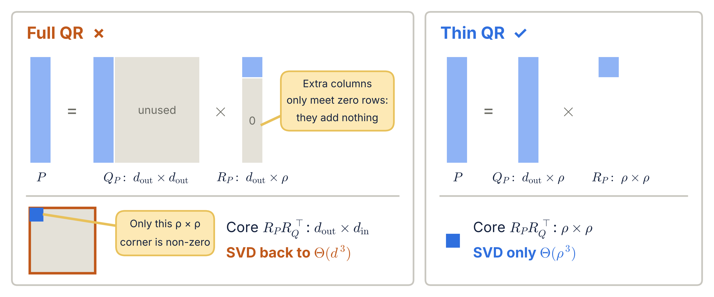
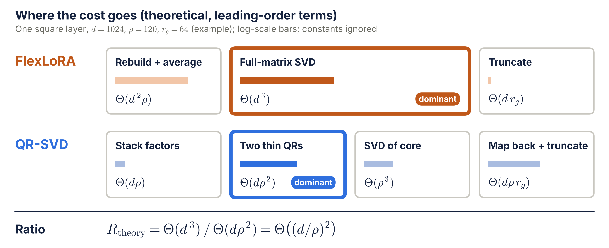

# Master's Thesis: Heterogeneous Federated Fine-Tuning of Foundation Models

**Thesis:** [Read the PDF on DiVA](https://uu.diva-portal.org/smash/get/diva2:2108786/FULLTEXT01.pdf)

## Background

**Federated learning (FL).** Instead of uploading large raw datasets to the cloud, FL allows institutions to train a shared model while keeping data local. This helps protect privacy, saves upload bandwidth, and supports edge deployments with local, real-time inference.

**LLM/VLM fine-tuning.** Large language models can be adapted to domain-specific tasks through fine-tuning. In this thesis, we use [Qwen3.5-0.8B](https://huggingface.co/Qwen/Qwen3.5-0.8B), a vision-language model with approximately 0.8 billion parameters.

**LoRA (Low-Rank Adaptation).** Updating all model parameters requires substantial GPU memory. LoRA is a parameter-efficient fine-tuning (PEFT) method that freezes the base model and learns updates through two small trainable matrices. Their inner dimension, **rank $r$**, controls adaptation capacity: higher ranks allow more flexible updates but require more trainable parameters, memory and communication. In our Qwen3.5-0.8B configuration, ranks of **8–64** correspond to **6.6M–52.7M trainable parameters**, or **0.8%–6.2%** of the full model’s **847M parameters**.

## Use case and experimental setting

**Dataset.** We use [PathVQA](https://huggingface.co/datasets/flaviagiammarino/path-vqa), a pathology visual question-answering dataset. Each sample contains an image, a question and its answer.

**Federated setting.** We consider four hospitals, each holding local pathology images and question–answer pairs. Regulatory constraints prevent them from sharing their raw data. Instead of each hospital fine-tuning its own model, they use **federated fine-tuning** to train a shared model while keeping data local.

The hospitals have different computing and GPU memory budgets, so they use different LoRA ranks: **64, 32, 16 and 8**. In our experiments, this setting is simulated using four clients with local partitions of PathVQA.

## How do we aggregate LoRA updates with different ranks?

The four hospitals have different computing and GPU memory budgets, so they use different LoRA ranks to control adaptation capacity and the number of trainable parameters. However, different ranks produce parameter matrices with different shapes, how can the server aggregate them?

| Method | Different ranks? | How the server aggregates | Limitation |
|---|:---:|---|---|
| **FedAvg** | ✗ | Averages $B$ and $A$ element-wise | Needs one shared rank |
| **HETLoRA** | ✓ | Zero-pads factors to a common rank and averages $B$ and $A$ separately; clients self-prune their rank | Averaging factors is not averaging updates: $\sum_k w_k B_k A_k \neq (\sum_k w_k B_k)(\sum_k w_k A_k)$; sensitive to the pruning parameter $\gamma$ |
| **FlexLoRA** | ✓ | Rebuilds each full update $B_k A_k$, averages, then truncates with an SVD | The full-matrix SVD is expensive: **42.52 s per round** on an NVIDIA A100 |

FlexLoRA: [Bai et al., NeurIPS 2024](https://proceedings.neurips.cc/paper_files/paper/2024/hash/1a134b50202088aa8c595cc99b310e5a-Abstract-Conference.html).

## What is QR-SVD?

To reduce the cost of FlexLoRA’s full-matrix SVD, we propose **QR-SVD**, the aggregation method developed in this thesis. It changes only the server step; local training and sending each client its top-$r_k$ factors stay the same as in FlexLoRA.

**① Stack the client factors.** The full update $W_g$ is never formed:

$$
W_g=\sum_{k=1}^{K} w_k B_k A_k = PQ,\qquad
P=\big[\sqrt{w_1}B_1\ \cdots\ \sqrt{w_K}B_K\big],\quad
Q=\big[\sqrt{w_1}A_1;\ \cdots;\ \sqrt{w_K}A_K\big].
$$

**② Thin QR on each side** leaves a small core $M$:

$$
P=Q_P R_P,\quad Q^{\top}=Q_Q R_Q
\quad\Longrightarrow\quad
W_g = Q_P\ \underbrace{R_P R_Q^{\top}}_{M\in\mathbb{R}^{\rho\times\rho}}\ Q_Q^{\top}.
$$

**③ SVD of the core only:** $M=U_M\Sigma_M V_M^{\top}$.

**④ Map back and truncate.** $Q_P U_M$ and $Q_Q V_M$ are the singular vectors of $W_g$, so keeping the top $r_g$ gives the same truncated update as FlexLoRA, up to floating-point error:

$$
B_g=Q_P U_M[:,:r_g]\ \Sigma_M[:r_g]^{1/2},\qquad
A_g=\Sigma_M[:r_g]^{1/2}\ \big(Q_Q V_M[:,:r_g]\big)^{\top}.
$$

Here, $d_{\mathrm{out}}$ and $d_{\mathrm{in}}$ denote the output and input dimensions of the adapted weight matrix.

**The key efficiency condition:** in the intended low-rank setting, the total client rank is much smaller than the full matrix dimensions:

$$
\rho=\sum_{k=1}^{K}r_k \ll \min(d_{\mathrm{out}},d_{\mathrm{in}}).
$$

For example, with $\rho=120$ and $d_{\mathrm{out}}=d_{\mathrm{in}}=1024$, the core SVD operates on a **120 × 120** matrix instead of a **1024 × 1024** matrix.

<b>Why thin QR, not full QR?</b>

Method: thesis §3.3–3.3.1. Local training follows FlexLoRA.

## Does QR-SVD preserve model accuracy?

**The evaluated runs achieve similar accuracy:** QR-SVD reaches **59.00%**, compared with FlexLoRA's **59.10%**, a difference of **0.10 percentage points**.

| Method | LoRA rank configuration | Final validation accuracy |
|---|---|---:|
| Centralized | r = 32 | 60.23% |
| FedAvg | r = 64 | 61.89% |
| FedAvg | r = 32 | 59.34% |
| HETLoRA | [64, 32, 16, 8], γ = 0.99 | 59.27% |
| FlexLoRA | [64, 32, 16, 8] | 59.10% |
| **QR-SVD** | **[64, 32, 16, 8]** | **59.00%** |

Source: thesis Table 5.5. Qwen3.5-0.8B on PathVQA validation (6,259 samples); federated scores are at round 9. Centralized r = 32 uses 1,000 steps with batch 256. The three heterogeneous methods differ by at most 0.27 percentage points in these runs.

## Where does the cost go?

Theoretical leading-order terms for one square layer ($d_{\mathrm{out}}=d_{\mathrm{in}}=d$), thesis Eq. 3.5. Constants and hardware are ignored, so the ratio shows how the gain scales, not the exact speedup; measured speedups follow below.

## How much faster is QR-SVD aggregation?

The figure combines the three model-proxy curves from thesis Figure 5.9 / Table 5.4. Each curve uses five runs on an A100; increasing the client count also increases the total rank.

$$
\mathrm{Speedup}_i=\frac{t_{\mathrm{FlexLoRA},i}}{t_{\mathrm{QR\text{-}SVD},i}},\qquad
\mathrm{plotted\ speedup}=\frac{1}{5}\sum_{i=1}^{5}\mathrm{Speedup}_i.
$$

Here, $t$ denotes aggregation time; larger values mean greater acceleration.

[Original five-run benchmark JSON](results/benchmarks) · [Recompute the summary](eval/summarize_benchmarks.py)

## What scenarios is QR-SVD best suited for?

**Cross-silo federated learning** involves a small, stable set of organizations training a shared model while keeping their data local. As the figure above shows, QR-SVD is particularly attractive for large weight matrices when the total participating LoRA rank $\rho$ is small relative to the matrix dimensions.

For setup and commands, see the [running guide](docs/running.md).

Accuracy values are reported thesis results; per-sample validation prediction files are not included in this snapshot.

