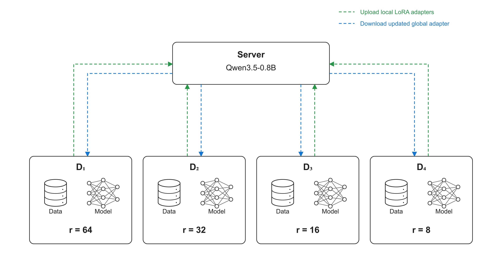
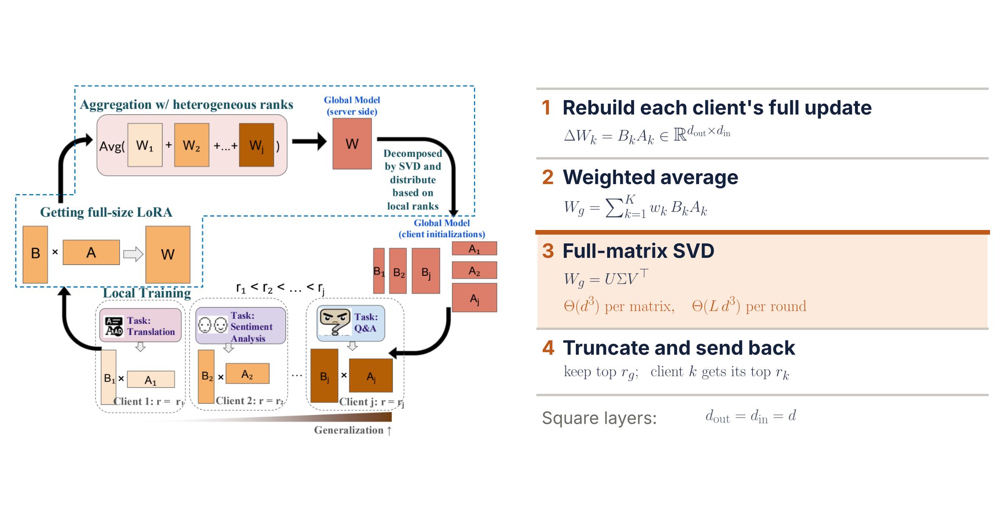
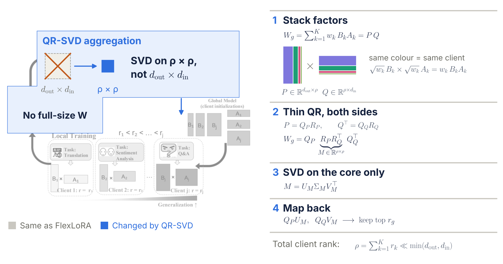
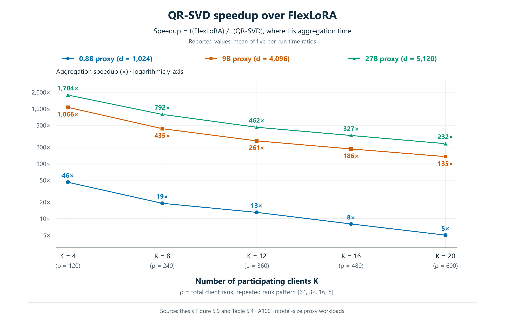

# Master's Thesis: Heterogeneous Federated Fine-Tuning of Foundation Models

**Thesis:** [Read the PDF on DiVA](https://uu.diva-portal.org/smash/get/diva2:2108786/FULLTEXT01.pdf)

**Contents**

- [Background](#background)
- [Use case and experimental setting](#use-case-and-experimental-setting)
- [How do we aggregate LoRA updates with different ranks?](#how-do-we-aggregate-lora-updates-with-different-ranks)
- [The efficient aggregation of FlexLoRA](#the-efficient-aggregation-of-flexlora)
  - [What is QR-SVD?](#what-is-qr-svd)
  - [Does it change the result?](#does-it-change-the-result)
  - [How much faster?](#how-much-faster)
  - [When does it help?](#when-does-it-help)
- [Scope and limitations](#scope-and-limitations)

## Background

**Federated learning (FL).** Instead of uploading large raw datasets to the cloud, FL allows institutions to train a shared model while keeping data local. This helps protect privacy, saves upload bandwidth, and supports edge deployments with local, real-time inference.

**LLM/VLM fine-tuning.** Large language models can be adapted to domain-specific tasks through fine-tuning. In this thesis, we use [Qwen3.5-0.8B](https://huggingface.co/Qwen/Qwen3.5-0.8B), a vision-language model with approximately 0.8 billion parameters.

**LoRA (Low-Rank Adaptation).** Updating all model parameters requires substantial GPU memory. LoRA is a parameter-efficient fine-tuning (PEFT) method that freezes the base model and learns updates through two small trainable matrices. Their inner dimension, **rank $r$**, controls adaptation capacity: higher ranks allow more flexible updates but require more trainable parameters, memory and communication. In our Qwen3.5-0.8B configuration, ranks of **8–64** correspond to **6.6M–52.7M trainable parameters**, or **0.8%–6.2%** of the full model’s **847M parameters**.

## Use case and experimental setting

**Dataset.** We use [PathVQA](https://huggingface.co/datasets/flaviagiammarino/path-vqa), a pathology visual question-answering dataset. Each sample contains an image, a question and its answer.

**Federated setting.** We consider four hospitals, each holding local pathology images and question–answer pairs. Regulatory constraints prevent them from sharing their raw data. Instead of each hospital fine-tuning its own model, they use **federated fine-tuning** to train a shared model while keeping data local.

The hospitals have different computing and GPU memory budgets, so they use different LoRA ranks: **64, 32, 16 and 8**. In our experiments, this setting is simulated using four clients with local partitions of PathVQA.

## How do we aggregate LoRA updates with different ranks?

The four hospitals have different computing and GPU memory budgets, so they use different LoRA ranks to control adaptation capacity and the number of trainable parameters. However, different ranks produce parameter matrices with different shapes, how can the server aggregate them?

| Method | Different ranks? | How the server aggregates | Limitation |
|---|:---:|---|---|
| **FedAvg** | ✗ | Averages $B$ and $A$ element-wise | Needs one shared rank |
| **HETLoRA** | ✓ | Zero-pads factors to a common rank and averages $B$ and $A$ separately; clients self-prune their rank | Averaging factors is not averaging updates: $\sum_k w_k B_k A_k \neq (\sum_k w_k B_k)(\sum_k w_k A_k)$; sensitive to the pruning parameter $\gamma$ |
| **FlexLoRA** | ✓ | Rebuilds each full update $B_k A_k$, averages, then truncates with an SVD | The full-matrix SVD is expensive: **42.52 s per round** on an NVIDIA A100 |

Left: Figure 2 of [Bai et al., NeurIPS 2024](https://proceedings.neurips.cc/paper_files/paper/2024/hash/1a134b50202088aa8c595cc99b310e5a-Abstract-Conference.html).

## The efficient aggregation of FlexLoRA

### What is QR-SVD?

**QR-SVD** changes only FlexLoRA’s server step: it never forms the full update and runs the SVD on a small $\rho\times\rho$ core instead of a $d_{\mathrm{out}}\times d_{\mathrm{in}}$ matrix.

Left: adapted from Figure 2 of [Bai et al., NeurIPS 2024](https://proceedings.neurips.cc/paper_files/paper/2024/hash/1a134b50202088aa8c595cc99b310e5a-Abstract-Conference.html), with permission. $d_{\mathrm{out}}, d_{\mathrm{in}}$: output and input dimensions of the adapted weight matrix. Method: thesis §3.3–3.3.1.

<b>Why thin QR, not full QR?</b>

### Does it change the result?

**No, up to floating-point error.** One aggregation step returns the same truncated update of rank $r_g$ as FlexLoRA (thesis §5.4.1). In the evaluated runs, QR-SVD reaches **59.00%** and FlexLoRA **59.10%** (single seed).

<b>All methods compared</b>

| Method | LoRA rank configuration | Final validation accuracy |
|---|---|---:|
| Centralized | r = 32 | 60.23% |
| FedAvg | r = 64 | 61.89% |
| FedAvg | r = 32 | 59.34% |
| HETLoRA | [64, 32, 16, 8], γ = 0.99 | 59.27% |
| FlexLoRA | [64, 32, 16, 8] | 59.10% |
| **QR-SVD** | **[64, 32, 16, 8]** | **59.00%** |

Source: thesis Table 5.5. Qwen3.5-0.8B on PathVQA validation (6,259 samples); federated scores are at round 9. Centralized r = 32 uses 1,000 steps with batch 256.

### How much faster?

**In theory** the gain grows as $(d/\rho)^2$ (thesis Eq. 3.5). **Measured** on one A100 with $\rho=120$:

| Model-size proxy | Adapted matrices | FlexLoRA | QR-SVD | Speedup |
|---|---:|---:|---:|---:|
| Qwen3.5-0.8B ($d=1024$) | 186 | 42.52 s | 0.923 s | **46×** |
| Qwen3.5-9B ($d=4096$) | 248 | 1727 s | 1.617 s | **1068×** |
| Qwen3.5-27B ($d=5120$) | 496 | 5861 s (≈ 98 min) | 3.268 s | **1793×** |

Server-side aggregation time per round, mean of five runs (thesis Table 5.3).

### When does it help?

- **Larger models gain more:** the speedup grows with $d$.
- **More clients or higher ranks gain less:** as $\rho$ approaches $d$, the gain shrinks (0.8B: 46× at 4 clients, 5× at 20).
- **Best fit:** cross-silo FL, with a few organizations and moderate ranks, so that $\rho \ll d$.

Speedup $=t_{\mathrm{FlexLoRA}}/t_{\mathrm{QR\text{-}SVD}}$, mean of five per-run ratios; 4 to 20 clients repeat the ranks [64, 32, 16, 8] ($\rho$ = 120 to 600). Source: thesis Figure 5.9 / Table 5.4.

## Scope and limitations

- Timings cover server-side aggregation only, on synthetic square proxy matrices, not end-to-end training.
- Accuracy comes from four clients with approximately IID data and a single seed.
- The theoretical ratio assumes square layers and ignores constants and hardware.
- Accuracy values are reported thesis results; per-sample prediction files are not included.
